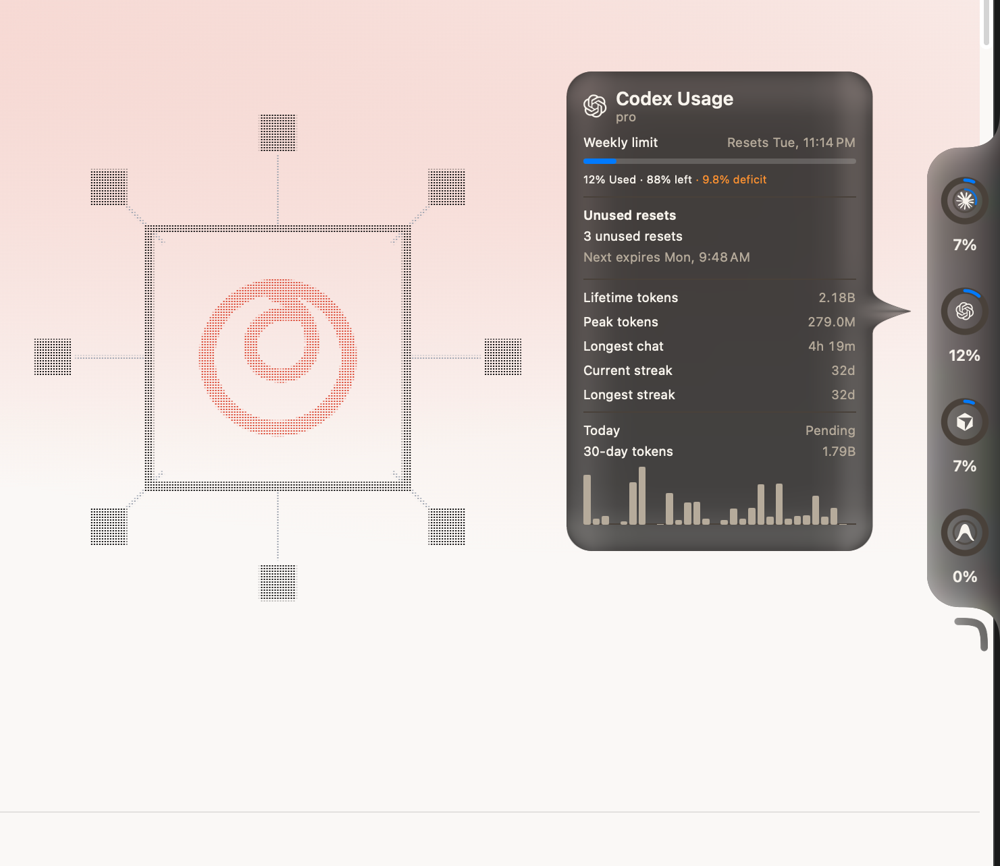
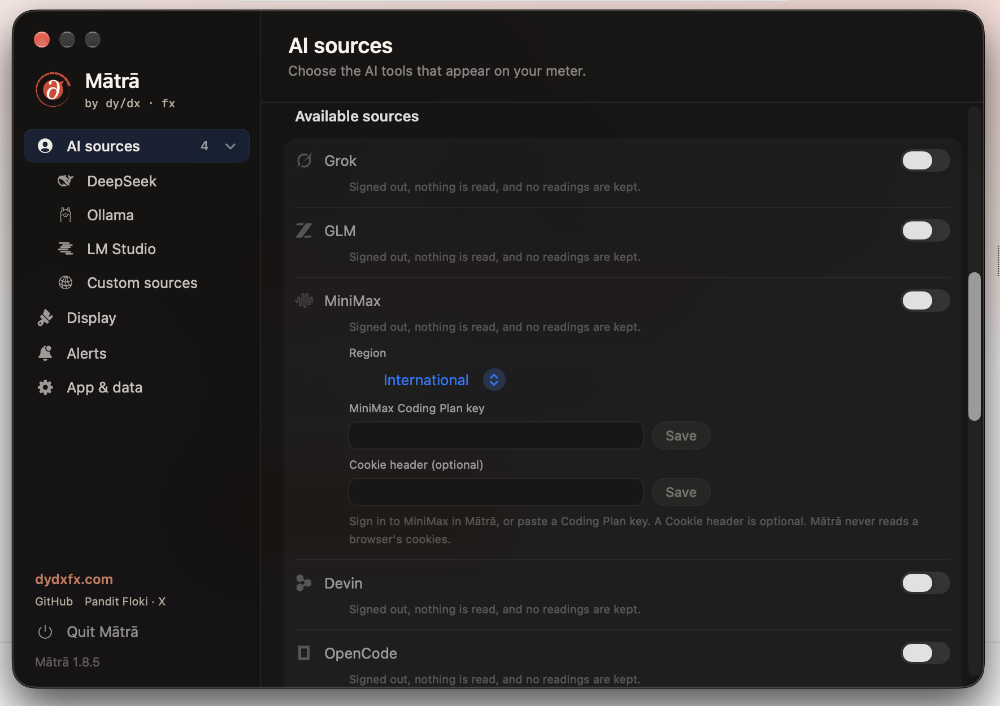
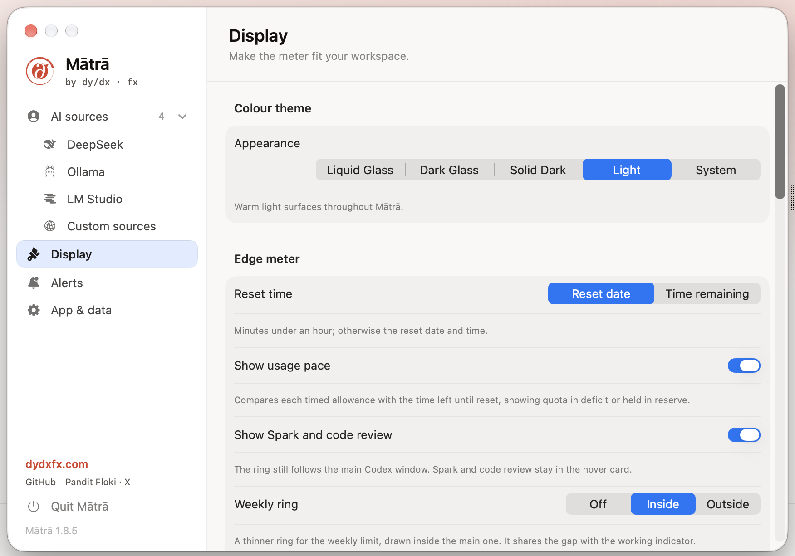

<p align="center">
  
</p>

<p align="center">
  <picture>
    <source media="(prefers-color-scheme: dark)" srcset="docs/readme/wordmark-dark.svg">
    <source media="(prefers-color-scheme: light)" srcset="docs/readme/wordmark-light.svg">
    
  </picture>
</p>

<h1 align="center">Your AI limits. Always in view.</h1>

<p align="center">
  See your usage, remaining allowance and reset times at the edge of your screen.<br>
  A quiet meter while you work. The detail when you need it.
</p>

<p align="center">
  <a href="https://github.com/panditfloki/matra/releases/download/v1.8.5-macos-beta.2/Matra-1.8.5-macOS-arm64-beta.2.dmg"></a>
  &nbsp;
  <a href="https://github.com/panditfloki/matra/releases/download/v1.8.6/Matra-Setup.exe"></a>
</p>

<p align="center">
  <a href="https://github.com/panditfloki/matra/releases/tag/v1.8.5-macos-beta.2">Mac release notes</a> ·
  <a href="https://github.com/panditfloki/matra/releases/tag/v1.8.6">Windows release notes</a> ·
  <a href="#install">Installation</a> ·
  <a href="LICENSE">MIT licence</a>
</p>

<p align="center"><sub>Mac: Apple Silicon, macOS 15+, beta, not notarized. Windows: x64, stable, unsigned installer. Separate release channels; manual updates.</sub></p>

<p align="center">
  <a href="#how-it-works">How it works</a> ·
  <a href="#your-tools-one-meter">Providers</a> ·
  <a href="#make-it-fit-your-workspace">Appearance</a> ·
  <a href="#choose-your-download">Downloads</a> ·
  <a href="#your-data">Your data</a>
</p>

<p align="center">
  <a href="docs/screenshots/macos-codex-glass.png"></a>
</p>
<p align="center"><sub>Actual macOS 1.8.5 preview, captured 30 September 2026. Values are historical examples. This capture predates the status-colour update; Windows has its own interface and feature coverage.</sub></p>

## Less checking. More context.

## 1.9 cross-platform preview

The latest Mac controls and Windows adaptation are available for testing. [Download both builds](https://github.com/panditfloki/matra/releases/tag/v1.9.0-beta.1) · [ROG/Mac test guide and platform coverage](native/PREVIEW-1.9.md).


Working across AI tools means keeping track of several allowances and reset windows. **Mātrā** (मात्रा, *measure*) brings supported readings into a compact desktop meter, so you can check them without opening another dashboard.

<table>
  <tr>
    <td width="50%"><strong>Allowance at a glance</strong><br>Rings show usage, with a separate weekly ring where available.</td>
    <td width="50%"><strong>Detail on hover</strong><br>Open a provider card for its limit windows, remaining allowance and reset times.</td>
  </tr>
  <tr>
    <td><strong>Activity beside usage</strong><br>See supported agents working, waiting for you or idle.</td>
    <td><strong>A place on your screen</strong><br>Choose placement, size, visibility and appearance to fit your workspace.</td>
  </tr>
  <tr>
    <td><strong>History when available</strong><br>Codex details include reset credits, token statistics and a 30-day history.</td>
    <td><strong>Honest about missing data</strong><br>Unavailable readings stay unavailable. Cached data is not a promise of live usage.</td>
  </tr>
</table>

## How it works

1. **Install your platform's build.** Windows stable and the Mac beta have separate downloads below.
2. **Choose your sources in Settings.** Reuse supported local sign-ins, or connect the integrations that need their own credentials. Enable the tools you use.
3. **Keep the meter nearby.** Glance at the rings, then hover over a provider for detail. Adjust the layout and appearance to suit your screen.

Mātrā displays what a provider makes available to your account. Fields can differ by plan, tool and signed-in session.

## Your tools, one meter

These integrations are included in the published **Windows 1.8.6** app. The Mac beta has additional source options; a source listed in Settings does not guarantee every metric is available.

| Source | What you can see |
| --- | --- |
| **Claude Code** | Session and weekly limits, reset times and supported activity states |
| **Codex** | Primary/weekly allowances, reset credits and expiry, lifetime/peak tokens, longest chat, streaks and 30-day daily token history |
| **Cursor** | Included usage, API usage and billing-cycle resets |
| **Antigravity** | Reported Gemini, Claude and GPT model-group allowances |
| **Grok** | Weekly allowance from the signed-in CLI session |
| **GLM** | Z.ai Coding Plan utilisation |

**Codex readings cover Codex.** Ordinary ChatGPT browser and app conversations are not included. Quota percentages, token counts and API-price estimates measure different things. An estimated API cost is not your subscription bill.

<details>
<summary><strong>See the Mac source settings</strong></summary>

<p></p>

Actual macOS 1.8.5 preview from 30 September 2026. This view shows optional source configuration, not connected-account verification. No key or sign-in is supplied with Mātrā.

</details>

## Make it fit your workspace

Choose **Liquid Glass, Dark Glass, Solid Dark, Light or System**. Adjust your meter's placement and appearance, then keep the readings you need in view.

<p align="center">
  <a href="docs/screenshots/macos-display-light.png"></a>
</p>
<p align="center"><sub>Mac 1.8.5 preview, captured 30 September 2026. Appearance and controls vary by platform. Native Mac glass requires macOS 26; older supported systems use solid surfaces.</sub></p>

Accent colours personalise the controls. Usage colours communicate how much allowance has been used:

| Default used allowance | Status |
| --- | --- |
| Below 50% | 🟢 Green |
| 50% to below 70% | 🟡 Amber |
| 70% to below 90% | 🟠 Orange |
| 90% and above | 🔴 Red |
| Unavailable | Neutral grey |

Watch and Critical thresholds are adjustable. Red takes priority from 90%. Windows also offers a smooth colour ramp. Notification settings are separate.

## Choose your download

| | macOS | Windows |
| --- | --- | --- |
| **Version** | **1.8.5 Beta 2**, build 186 | **1.8.6 Stable** |
| **Platform** | Apple Silicon · macOS 15+ | Windows x64 |
| **Package** | [Download DMG](https://github.com/panditfloki/matra/releases/download/v1.8.5-macos-beta.2/Matra-1.8.5-macOS-arm64-beta.2.dmg) | [Download Setup.exe](https://github.com/panditfloki/matra/releases/download/v1.8.6/Matra-Setup.exe) |
| **Integrity** | [SHA256SUMS.txt](https://github.com/panditfloki/matra/releases/download/v1.8.5-macos-beta.2/SHA256SUMS.txt) | [SHA256SUMS.txt](https://github.com/panditfloki/matra/releases/download/v1.8.6/SHA256SUMS.txt) |
| **Signing** | Ad-hoc signed; not Apple notarized | Not publisher-signed |
| **Updates** | Manual beta installation | Run the newer installer |

Download versions checked on **30 October 2026**. Mac and Windows are released separately; Mac screenshots do not establish Windows feature parity.

### In the current releases

**Mac Beta 2:** menu-bar Overview and provider tabs; a side detail panel on hover or pin; optional provider brand colours; local Claude/Codex token counts and USD API-price estimates through an installed `ccusage`. Unknown readings stay neutral. [Mac release notes](https://github.com/panditfloki/matra/releases/tag/v1.8.5-macos-beta.2).

**Windows 1.8.6:** the notch keeps its topmost position while preserving focus; settings and drag controls reveal below the capsule; dated Claude readings stay visible when the first refresh is rate-limited. Codex statistics, reset credits and the 30-day graph are retained. [Windows release notes](https://github.com/panditfloki/matra/releases/tag/v1.8.6).

## Install

### Mac

1. Download the **DMG** and its **SHA256SUMS.txt** from the [Mac beta release](https://github.com/panditfloki/matra/releases/tag/v1.8.5-macos-beta.2).
2. Quit Mātrā, open the DMG and drag **Matra.app** into **Applications**.
3. Eject the disk image and launch Mātrā from Applications.

The beta requires an Apple Silicon Mac with macOS 15 or later. An Intel installer is not included. It uses an ad-hoc signed developer build; Developer ID signing and Apple notarization remain pending. If macOS blocks it, stop and review the warning with protections enabled.

Existing preferences and provider sign-ins are retained when replacing the app. Install beta updates manually: the automatic-install preference is present, but a published signed update feed and complete downloaded-upgrade test are still pending.

<details>
<summary><strong>Check the Mac download</strong></summary>

```sh
shasum -a 256 ~/Downloads/Matra-1.8.5-macOS-arm64-beta.2.dmg
```

Compare the result with the checksum supplied in the same release. A matching hash checks file integrity; it does not establish Apple notarization.

</details>

### Windows

1. Download **Matra-Setup.exe** and **SHA256SUMS.txt** from the [Windows stable release](https://github.com/panditfloki/matra/releases/tag/v1.8.6).
2. Run Setup, then open Mātrā from the Start menu.
3. For an existing installation, run the newer installer to upgrade. Preferences and enabled integrations are retained.

The installer is per-user and does not need administrator rights. It is not publisher-signed, so Windows may display a warning. Verify the source and checksum before deciding whether to run it. Updates are manual; an automatic update feed is not configured for this release.

<details>
<summary><strong>Check the Windows download</strong></summary>

```powershell
Get-FileHash -Algorithm SHA256 "$env:USERPROFILE\Downloads\Matra-Setup.exe"
```

Compare the result with the checksum supplied in the same release. A matching hash checks file integrity; it is not a publisher signature.

</details>

## Your data

Mātrā reads supported local sessions, usage records and provider APIs. **No separate Mātrā account is required**, and your usage does not pass through a Mātrā-hosted service.

- Credentials are used with the provider that owns them. Some integrations need an explicit sign-in or API key.
- Readings can be cached, unavailable or limited by an expired session. Freshness varies by source.
- Some provider endpoints are undocumented and may change.
- GitHub is used for release downloads and update-related checks.

The legacy dashboard has separate data paths, including an optional USD/INR rate request. See the [legacy guide](docs/LEGACY-DASHBOARD.md).

## Build and contribute

The desktop apps have separate native implementations. The older Electron experiment in `desktop/` is not the shipping Windows app.

| Platform | Implementation | Start here |
| --- | --- | --- |
| **macOS** | Swift / AppKit | [Mac build notes and pinned dependencies](native/macos/README.md) |
| **Windows** | Rust / Tauri 2 / WebView2 | [Native build notes](native/README.md) · [Windows CI](.github/workflows/windows.yml) |

<details>
<summary><strong>Build commands</strong></summary>

With the documented platform prerequisites installed:

**macOS**

```sh
cd native/macos
make build
make test
```

**Windows**

```powershell
npm run native:test
npm run native:build
npm run native:bundle
```

Keep changes scoped to the relevant platform and preserve dependency pins. A local build is separate from a signed installer or a verified installed update.

</details>

**Using the original IDE extension or localhost dashboard?** The existing VS Code-compatible extension and `localhost:4317` dashboard remain in the repository. Their installation, currency settings and architecture are in the [legacy guide](docs/LEGACY-DASHBOARD.md).

<details>
<summary><strong>Screenshot provenance</strong></summary>

The app images on this page are unchanged captures of the macOS 1.8.5 preview from 30 September 2026, previously published with the owner's approval. Their usage numbers are historical examples. The hero's blue arcs predate the status-colour update; current defaults are described above. The source settings image includes disabled or signed-out integrations. These images are not captures of Windows or of every Beta 2 addition.

[Alternate Codex capture](docs/screenshots/macos-codex-glass-alternate.png) · [Brand artwork](media/brand/README.md)

</details>

---

<p align="center"><strong>Mātrā · मात्रा · measure</strong><br>Built by <strong>Pandit Floki</strong> at <strong>DYDXFX</strong>.</p>

<p align="center">
  <a href="https://dydxfx.com">Website</a> ·
  <a href="https://github.com/panditfloki/matra/issues">Report an issue</a> ·
  <a href="https://github.com/panditfloki/matra/releases">All releases</a> ·
  <a href="LICENSE">MIT licence</a>
</p>

<p align="center"><sub>Independent project; not affiliated with the AI providers. Provider names and marks belong to their owners.<br>© 2026 dydxfx · <a href="https://dydxfx.com">dydxfx.com</a></sub></p>
